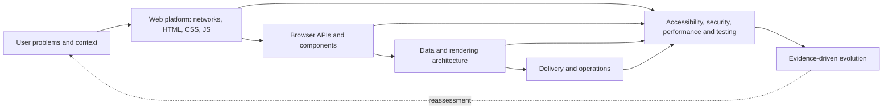

# Front-end Development · Knowledge Atlas (October 2026)

**Purpose.** A dependency-aware map of browser-delivered front-end development: foundational knowledge, applied engineering, assurance, specialized systems and emerging capabilities.

**Reading rule.** A topic’s category says *what it is*; its tier says *when to prioritize it*. “Frontier” does not mean better, or automatically production-ready.

**Coverage:** 16 domains · 114 capabilities · 204 prerequisite links.

## System map

## Complete domain atlas

### 01 · Product, users & information — Understand
Start from human goals and constraints, not a preferred framework.

- **User outcomes and constraints** [Core]. Jobs to be done, users, constraints, accessibility needs, risks, business outcomes. **Demonstrate:** Write a problem statement, user scenarios and measurable outcomes.
- **Research and discovery** [Practice]. Interviews, observation, analytics, task analysis, evidence quality and research ethics. **Demonstrate:** Test an assumption with users and record findings. **Requires:** User outcomes and constraints.
- **Information architecture** [Practice]. Mental models, navigation, naming, content structure, taxonomy and findability. **Demonstrate:** Produce a navigable sitemap and task flows. **Requires:** Research and discovery.
- **Interaction design** [Practice]. Affordances, feedback, error recovery, state transitions, forms and empty/loading/error states. **Demonstrate:** Prototype one complete task including failure states. **Requires:** User outcomes and constraints.
- **Content design and SEO intent** [Practice]. Clear language, structured content, metadata, crawlability, search intent and preview cards. **Demonstrate:** Make a page intelligible with and without scripting. **Requires:** Information architecture, Document semantics.
- **Localization and internationalization** [Practice]. Languages, locale formatting, plural rules, directionality, scripts and text expansion. **Demonstrate:** Ship RTL and localized date/number demos. **Requires:** Document semantics, Modern layout and responsive design.
- **Trust and responsible UX** [Practice]. Privacy, dark-pattern avoidance, consent, transparent feedback and inclusive decisions. **Demonstrate:** Audit a product flow for manipulation and ambiguity. **Requires:** Interaction design, Privacy by design.

### 02 · Internet & browser systems — Understand
Learn the actual distributed system and browser runtime that executes the UI.

- **HTTP, DNS, TLS and URLs** [Core]. DNS, HTTPS/TLS, methods, status codes, headers, content negotiation, origin and transport. **Demonstrate:** Trace a browser request from URL to response in DevTools.
- **Browser architecture** [Core]. HTML parsing, DOM, CSSOM, style, layout, paint, compositing, event loop and rendering pipeline. **Demonstrate:** Diagnose a forced layout and long main-thread task. **Requires:** HTTP, DNS, TLS and URLs.
- **Navigation and lifecycle** [Practice]. History, navigation, reloads, bfcache, page lifecycle, prefetching and resource hints. **Demonstrate:** Explain a reload, a soft route transition and back navigation. **Requires:** Browser architecture.
- **HTTP and application caching** [Practice]. Cache-Control, CDN, ETag, validators, service-worker caching, invalidation and stale data. **Demonstrate:** Design a cache policy with an invalidation story. **Requires:** HTTP, DNS, TLS and URLs.
- **Origins, CORS and isolation** [Practice]. Same-origin policy, CORS, cookies, cross-origin isolation and postMessage. **Demonstrate:** Debug a CORS failure without disabling protection. **Requires:** HTTP, DNS, TLS and URLs.
- **Critical resource loading** [Practice]. Parsing, preload, async/defer, priorities, CSS/JS ordering, image discovery and fonts. **Demonstrate:** Show a waterfall before and after eliminating render blocking. **Requires:** Browser architecture.
- **Network variance and offline reality** [Practice]. Latency, packet loss, mobile data, flaky networks and failures as normal states. **Demonstrate:** Handle slow/offline/timeout cases without losing user work. **Requires:** Interaction design, HTTP, DNS, TLS and URLs.

### 03 · Semantic HTML & progressive web — Build
Use the platform’s built-in meaning and interaction before adding layers.

- **Document semantics** [Core]. Document landmarks, headings, lists, tables, links, buttons, article/section, accessible name. **Demonstrate:** Build a usable page with native semantic HTML only. **Requires:** User outcomes and constraints.
- **Forms and validation** [Core]. Labels, fieldsets, input types, autocomplete, constraint validation, submission and error help. **Demonstrate:** Build a robust form with native behavior and clear errors. **Requires:** Document semantics.
- **Progressive enhancement** [Core]. Working baseline first; enhance when JavaScript and newer APIs are available. **Demonstrate:** Complete key task with JavaScript disabled. **Requires:** HTTP, DNS, TLS and URLs, Document semantics.
- **Media and responsive images** [Practice]. Picture, srcset, sizes, loading, decoding, captions, tracks and media accessibility. **Demonstrate:** Serve correctly sized images and accessible video. **Requires:** Document semantics.
- **Metadata, structured data and indexing** [Practice]. Canonical, robots, titles, metadata, JSON-LD where appropriate, social previews. **Demonstrate:** Validate indexability and meaningful page previews. **Requires:** Content design and SEO intent, Document semantics.
- **Native interactive primitives** [Practice]. Dialog, details, popover, validation, inert and invoker commands where supported. **Demonstrate:** Replace a custom widget with a semantic native primitive. **Requires:** Document semantics, Keyboard, focus and controls.
- **Custom elements and shadow DOM** [Specialist]. Custom elements, templates, slots, shadow roots, declarative shadow DOM, encapsulation tradeoffs. **Demonstrate:** Publish a framework-independent element with documented semantics. **Requires:** Document semantics, Modules, package boundaries and composition.

### 04 · CSS, layout & design systems — Build
Treat CSS as a layout, constraint and state language, not a bag of utilities.

- **Cascade, specificity and inheritance** [Core]. Origins, cascade layers, custom properties, inheritance, selectors and computed styles. **Demonstrate:** Debug why a style wins without adding !important. **Requires:** Document semantics.
- **Modern layout and responsive design** [Core]. Box model, logical properties, Grid, Flexbox, subgrid, intrinsic sizing and container queries. **Demonstrate:** Rebuild one layout for narrow, wide and RTL screens. **Requires:** Cascade, specificity and inheritance.
- **Typography and visual hierarchy** [Practice]. Font loading, line length, fluid type, color, contrast, spacing and composition. **Demonstrate:** Deliver a readable layout at 200% zoom. **Requires:** Modern layout and responsive design.
- **Tokens, themes and component contracts** [Practice]. Semantic tokens, CSS variables, dark mode, theme scopes, component variants, brand constraints. **Demonstrate:** Implement two themes without duplicating component rules. **Requires:** Cascade, specificity and inheritance, Typography and visual hierarchy.
- **Modern declarative CSS** [Practice]. Nesting, :has(), @scope, container styles, anchor positioning and support-aware fallbacks. **Demonstrate:** Eliminate avoidable JS using a compatible CSS primitive. **Requires:** Browser architecture, Modern layout and responsive design.
- **Motion and transitions** [Practice]. Transitions, keyframes, view transitions, perceived continuity, prefers-reduced-motion. **Demonstrate:** Design a transition that remains understandable with motion reduced. **Requires:** Modern layout and responsive design, Motion, cognition and sensory access.
- **Visual assets, icons and illustration** [Specialist]. SVG authoring, sprite strategies, raster optimization, compositing and color systems. **Demonstrate:** Build an asset pipeline with dimensions, compression and alt text. **Requires:** Media and responsive images, Typography and visual hierarchy.

### 05 · JavaScript, TypeScript & programming — Build
Learn language mechanics well enough to reason about correctness and complexity.

- **JavaScript semantics** [Core]. Types, coercion, closures, scope, prototypes, iterables, errors, objects and functions. **Demonstrate:** Explain a closure bug and write predictable transformations. **Requires:** Browser architecture.
- **Modules, package boundaries and composition** [Core]. ES modules, import/export, module graphs, boundaries, pure functions and side effects. **Demonstrate:** Split a program into testable modules with clear APIs. **Requires:** JavaScript semantics.
- **Asynchrony and event loop** [Core]. Promises, async/await, microtasks, tasks, cancellation, race conditions and AbortController. **Demonstrate:** Implement cancellation and prevent stale responses. **Requires:** Browser architecture, JavaScript semantics.
- **TypeScript modeling** [Core]. Types vs runtime values, unions, narrowing, generics, inference, strictness, unknown and type guards. **Demonstrate:** Model invalid states out of a feature and validate inputs at runtime. **Requires:** JavaScript semantics, Modules, package boundaries and composition.
- **Functional and data modeling** [Practice]. Immutability, pure logic, normalization, schemas, parsing, serialization and date/time pitfalls. **Demonstrate:** Create reliable transformations with property tests. **Requires:** JavaScript semantics, TypeScript modeling.
- **Complexity and data structures** [Practice]. Time/space complexity, arrays, maps, sets, trees, queues, graphs and streaming. **Demonstrate:** Optimize a filter/search without harming correctness. **Requires:** JavaScript semantics.
- **Concurrency and workers** [Specialist]. Web Workers, message passing, transferables, SharedArrayBuffer prerequisites and Worklets. **Demonstrate:** Move expensive computation off the main thread. **Requires:** Origins, CORS and isolation, Asynchrony and event loop.

### 06 · Web platform APIs — Build
Know what the browser already provides; design for permissions and fallbacks.

- **DOM, events and focus** [Core]. DOM mutation, bubbling/capture, delegation, focus, selection, observers and custom events. **Demonstrate:** Build an accessible interactive widget in vanilla JS. **Requires:** Document semantics, JavaScript semantics.
- **Fetch, streams and resource APIs** [Practice]. Fetch, Request/Response, streams, aborting, uploads, errors and backpressure. **Demonstrate:** Render a cancellable async loading flow. **Requires:** HTTP, DNS, TLS and URLs, Asynchrony and event loop.
- **Client storage and persistence** [Practice]. localStorage, IndexedDB, Cache API, persistence limits, cookies and data sensitivity. **Demonstrate:** Store recoverable drafts with an expiry/migration policy. **Requires:** Origins, CORS and isolation, Asynchrony and event loop.
- **Observers and scheduling** [Practice]. Intersection/Resize/Mutation observers, rAF, idle work, scheduling and visibility. **Demonstrate:** Virtualize a view while preserving user focus. **Requires:** Browser architecture, DOM, events and focus.
- **Navigation and transition APIs** [Practice]. History/Navigation APIs, page transitions, scroll restoration and progressive fallbacks. **Demonstrate:** Keep navigation correct with or without transitions. **Requires:** Navigation and lifecycle, DOM, events and focus.
- **Service workers and PWA APIs** [Specialist]. Service worker lifecycle, installability, push, background sync support, offline strategy. **Demonstrate:** Implement offline read access and update notifications. **Requires:** HTTP and application caching, Client storage and persistence.
- **Graphics and computation APIs** [Specialist]. Canvas, SVG, WebGL, WebGPU, WebAssembly, Audio and platform capability detection. **Demonstrate:** Compare fallback and accelerated renderers on target devices. **Requires:** Browser architecture, Concurrency and workers.

### 07 · UI component engineering & state — Architect
Compose predictable interfaces with explicit state, behavior and ownership.

- **Components, composition and props** [Core]. Boundaries, slots/children, cohesion, contracts, controlled vs uncontrolled APIs. **Demonstrate:** Ship a reusable component with a documented API. **Requires:** Document semantics, Modern layout and responsive design, Modules, package boundaries and composition.
- **Local state and state machines** [Core]. State ownership, events, derived state, reducers, invariants, transitions and impossible states. **Demonstrate:** Model loading/success/error with no contradictory states. **Requires:** TypeScript modeling, Components, composition and props.
- **Reactive rendering and lifecycle** [Practice]. Signals/hooks/observables, effect timing, cleanup, identity, reconciliation and batching. **Demonstrate:** Debug repeated renders and stale closures. **Requires:** Asynchrony and event loop, Local state and state machines.
- **Shared state and dependency boundaries** [Practice]. Context, stores, signals, event buses and avoiding accidental global state. **Demonstrate:** Justify each shared state boundary and avoid duplication. **Requires:** Local state and state machines.
- **Remote/server state** [Practice]. Fetching, deduplication, cache keys, mutations, invalidation, retries and stale-while-revalidate. **Demonstrate:** Maintain consistency after failed optimistic changes. **Requires:** Fetch, streams and resource APIs, Local state and state machines.
- **Design system and component library** [Practice]. Tokens, accessible primitives, composition, documentation, versioning, governance. **Demonstrate:** Release 5 consistent, tested accessible primitives. **Requires:** Tokens, themes and component contracts, Components, composition and props, Keyboard, focus and controls.
- **Complex form interaction** [Practice]. Schema validation, conditional fields, async validation, errors, autosave and recovery. **Demonstrate:** Ship a multi-step form preserving user data. **Requires:** Forms and validation, Local state and state machines.
- **Framework mental models** [Practice]. Compare React, Vue, Angular, Svelte, Solid and Web Components by state/render semantics. **Demonstrate:** Implement same feature in vanilla DOM and one framework. **Requires:** Asynchrony and event loop, Components, composition and props.

### 08 · Rendering & system architecture — Architect
Choose rendering, boundaries and deployment based on product constraints.

- **CSR, SSR, SSG and hybrid rendering** [Core]. Client/server rendering, static generation, streamed SSR, hydration and their costs. **Demonstrate:** Explain first HTML, JS requirements and navigation behavior. **Requires:** Browser architecture, Progressive enhancement, Components, composition and props.
- **Islands and partial hydration** [Practice]. Static shell with selectively interactive islands; hydration islands vs fine-grained resumption. **Demonstrate:** Render a content-heavy page with minimal client JS. **Requires:** CSR, SSR, SSG and hybrid rendering.
- **Server components and server functions** [Practice]. Server/client module boundaries, streaming, serialization, actions and authorization. **Demonstrate:** Trace exactly what runs server-side vs browser-side. **Requires:** CSR, SSR, SSG and hybrid rendering, Authentication vs authorization.
- **Routing and URL state** [Practice]. Nested routes, URL params, data loading, transitions, history and error boundaries. **Demonstrate:** Make deep links and browser back work predictably. **Requires:** Navigation and lifecycle, Local state and state machines.
- **Domain and module architecture** [Practice]. Feature slices, dependency inversion, maintainability, layering, modular monolith and microfrontend costs. **Demonstrate:** Draw a dependency graph with enforceable boundaries. **Requires:** Modules, package boundaries and composition, Components, composition and props.
- **CDN, edge and caching architecture** [Specialist]. Origin vs edge compute, regionalization, personalization, cache control and invalidation. **Demonstrate:** Place logic deliberately among browser, edge and origin. **Requires:** HTTP and application caching, CSR, SSR, SSG and hybrid rendering.
- **Loading and failure architecture** [Practice]. Timeouts, fallbacks, offline states, suspense/loading boundaries, recoverable errors. **Demonstrate:** Test a partial failure without a blank screen. **Requires:** Network variance and offline reality, Local state and state machines.

### 09 · Data exchange & backend contracts — Architect
Ensure UI behavior respects server authority and distributed state.

- **API contracts and schemas** [Core]. REST/GraphQL/RPC tradeoffs, JSON, status semantics, schema validation, versioning. **Demonstrate:** Consume a typed API with failure handling and input validation. **Requires:** HTTP, DNS, TLS and URLs, TypeScript modeling.
- **Authentication vs authorization** [Core]. Sessions, cookies, passkeys, tokens, permissions and server-enforced authorization. **Demonstrate:** Describe auth flow without claiming UI guards secure data. **Requires:** Origins, CORS and isolation, Forms and validation.
- **Consistency and optimistic UI** [Practice]. Server authority, optimistic updates, rollback, idempotency, retries, dedupe and conflicts. **Demonstrate:** Handle two clients editing the same record. **Requires:** Remote/server state, API contracts and schemas.
- **Real-time and streaming UX** [Practice]. WebSockets, SSE, polling, streaming response, presence, reconnect, backpressure. **Demonstrate:** Build a reconnecting live update view with stale indication. **Requires:** Asynchrony and event loop, Fetch, streams and resource APIs.
- **Search, filters and pagination** [Practice]. URL-query sync, server vs local search, pagination, cursors, sorting, virtualization. **Demonstrate:** Create stable shareable filter states. **Requires:** Routing and URL state, API contracts and schemas.
- **File transfer and large data** [Specialist]. Multipart uploads, chunking, previews, validation, memory use and streaming. **Demonstrate:** Upload a large file with progress and cancellation. **Requires:** Fetch, streams and resource APIs, XSS, injection and safe rendering.
- **Backend for frontend and aggregation** [Specialist]. API composition, secrets boundaries, session adaptation, cost and latency. **Demonstrate:** Explain when BFF is safer than direct browser access. **Requires:** CDN, edge and caching architecture, API contracts and schemas.

### 10 · Accessibility & inclusive interaction — Assure
Accessibility is an invariant across all branches, not a final polish pass.

- **Semantic and accessible names** [Core]. Native semantics, names, descriptions, landmarks, form labels and screen reader output. **Demonstrate:** Audit and repair an accessible name computation. **Requires:** Document semantics.
- **Keyboard, focus and controls** [Core]. Tab order, visible focus, dialogs, menus, focus restoration, escape and traps. **Demonstrate:** Complete all core tasks with keyboard only. **Requires:** DOM, events and focus, Semantic and accessible names.
- **WCAG and conformance evidence** [Practice]. WCAG 2.2 perceivable/operable/understandable/robust; levels; tests and limits. **Demonstrate:** Create a mapped audit with manual and automated findings. **Requires:** Typography and visual hierarchy, Keyboard, focus and controls.
- **ARIA authoring patterns** [Practice]. Roles, states, properties, live regions and the first rule of ARIA: prefer HTML. **Demonstrate:** Make an ARIA widget work with real assistive technology. **Requires:** Semantic and accessible names, Keyboard, focus and controls.
- **Motion, cognition and sensory access** [Practice]. Reduced motion, contrast, reflow, target sizes, cognitive load and predictable help. **Demonstrate:** Test zoom, color contrast, reduced motion and error guidance. **Requires:** Typography and visual hierarchy, WCAG and conformance evidence.
- **Assistive technology testing** [Practice]. Screen readers, mobile accessibility, voice control, keyboard, real user research. **Demonstrate:** Record manual AT results rather than only axe scores. **Requires:** WCAG and conformance evidence.
- **Accessible design systems** [Specialist]. Keyboard patterns, component contracts, token constraints, upstream a11y governance. **Demonstrate:** Write accessible component specifications and CI checks. **Requires:** Design system and component library, Assistive technology testing.

### 11 · Performance & reliability — Assure
Optimize measured user outcomes, not lighthouse scores in isolation.

- **Core Web Vitals and field measurement** [Core]. LCP, INP, CLS; field percentiles, device segments, lab-vs-field differences. **Demonstrate:** Report p75 metrics segmented by device and route. **Requires:** Browser architecture.
- **Network and loading optimization** [Practice]. Critical path, preload, resource priorities, image formats, fonts, CDN and compression. **Demonstrate:** Improve LCP using before/after waterfalls and RUM. **Requires:** Critical resource loading, Core Web Vitals and field measurement.
- **Interaction responsiveness** [Practice]. Long tasks, scheduling, render costs, input latency, yielding, workers and hydration cost. **Demonstrate:** Diagnose and improve a slow interaction INP trace. **Requires:** Asynchrony and event loop, Core Web Vitals and field measurement.
- **Visual stability and rendering cost** [Practice]. Intrinsic sizing, image dimensions, animations, layout shifts, containment and paint. **Demonstrate:** Eliminate layout shifts without hiding meaningful content. **Requires:** Modern layout and responsive design, Core Web Vitals and field measurement.
- **Budgets and cost accounting** [Practice]. JS/CSS transfer, parse/execute, memory, battery, CPU, data and third-party cost. **Demonstrate:** Set mobile budgets and enforce regression gates. **Requires:** Core Web Vitals and field measurement, Continuous integration and release.
- **Observability and real-user monitoring** [Practice]. RUM, errors, traces, SLOs, attribution, cohort analysis and privacy-preserving telemetry. **Demonstrate:** Correlate performance regression with release and device. **Requires:** Core Web Vitals and field measurement, Errors, logs and observability.
- **Graceful degradation and recoverability** [Specialist]. Timeouts, fallbacks, stale content, offline recovery and error containment. **Demonstrate:** Rescue user workflow from connection loss. **Requires:** Network variance and offline reality, Service workers and PWA APIs.

### 12 · Security, privacy & trust — Assure
Treat browser UI as untrusted code and server-side authority as nondelegable.

- **Threat modeling and trust boundaries** [Core]. Assets, attackers, abuse cases, trust boundaries, least privilege and OWASP Top 10. **Demonstrate:** Write one realistic abuse-case test for each sensitive flow. **Requires:** Origins, CORS and isolation, Authentication vs authorization.
- **XSS, injection and safe rendering** [Core]. Output encoding, URL sanitization, DOM sinks, safe templating, Trusted Types and user content. **Demonstrate:** Prevent injection into HTML, URL and script contexts. **Requires:** Document semantics, JavaScript semantics.
- **Sessions, CSRF and browser controls** [Practice]. SameSite, CSRF tokens, cookie flags, session fixation, CORS vs CSRF differences. **Demonstrate:** Document session threat model and CSRF mitigation. **Requires:** Origins, CORS and isolation, Authentication vs authorization.
- **CSP, headers and isolation** [Practice]. CSP, nonces, SRI, Permissions-Policy, HSTS and robust response headers. **Demonstrate:** Enable report-only then enforce a restrictive CSP. **Requires:** HTTP, DNS, TLS and URLs, XSS, injection and safe rendering.
- **Dependency and supply-chain defense** [Practice]. Lockfiles, SBOMs, provenance, malicious packages, secret scanning, dependency updates. **Demonstrate:** Pin dependencies and respond to a compromised package. **Requires:** Threat modeling and trust boundaries, Package and dependency management.
- **Privacy by design** [Practice]. Data minimization, storage limits, third-party risk, consent, deletion and access controls. **Demonstrate:** Map personal data flow and eliminate unnecessary collection. **Requires:** Trust and responsible UX, Client storage and persistence.
- **AI feature threat model** [Frontier]. Prompt injection, unsafe tool access, untrusted model output, exfiltration and content provenance. **Demonstrate:** Sandbox model output and human-review sensitive actions. **Requires:** Threat modeling and trust boundaries, AI-assisted engineering and AI-native UX.

### 13 · Testing & correctness — Assure
Use independent evidence about behavior in realistic contexts.

- **Testing strategy and risk** [Core]. Test pyramid alternatives, risk-based coverage, unit/integration/contract/E2E boundaries. **Demonstrate:** Explain which failures each test tier catches. **Requires:** Modules, package boundaries and composition, Local state and state machines.
- **Unit and property testing** [Practice]. Pure logic, edge cases, invariants, generators, fakes and deterministic execution. **Demonstrate:** Write property tests for parsers and reducers. **Requires:** Functional and data modeling, Testing strategy and risk.
- **Component and interaction testing** [Practice]. Accessible queries, states, mocked network conditions, user events and error paths. **Demonstrate:** Test a form as the user operates it. **Requires:** Components, composition and props, Testing strategy and risk.
- **Cross-browser end-to-end testing** [Practice]. Playwright/Cypress, realistic browsers, auth flows, flakiness and critical journeys. **Demonstrate:** Run critical journeys across supported engines and devices. **Requires:** Component and interaction testing, Continuous integration and release.
- **Visual and responsive regression** [Practice]. Visual diffs, snapshots, responsive matrix, themes and font/platform variation. **Demonstrate:** Detect an RTL, dark mode or 200% zoom regression. **Requires:** Modern layout and responsive design, Component and interaction testing.
- **Contract, load and failure testing** [Specialist]. Schema compatibility, API mocks, fault injection, latency/load tests, rollback readiness. **Demonstrate:** Catch a breaking API change before deployment. **Requires:** API contracts and schemas, Testing strategy and risk.
- **Accessibility and security verification** [Practice]. Automated a11y, manual AT, SAST/DAST/dependency scans, evidence retention. **Demonstrate:** Combine automated checks with manual validation. **Requires:** Assistive technology testing, Threat modeling and trust boundaries, Continuous integration and release.

### 14 · Tooling, collaboration & delivery — Operate
Make changes reproducible, reviewable, observable and reversible.

- **Git, collaboration and review** [Core]. Branching, rebasing, commits, pull requests, code review and technical communication. **Demonstrate:** Deliver a small reviewed change with clear rationale.
- **Package and dependency management** [Core]. Node runtime/LTS, package managers, semver, lockfiles, workspace constraints and audit. **Demonstrate:** Reproduce install in a clean environment. **Requires:** Modules, package boundaries and composition.
- **Build and bundling pipeline** [Practice]. Vite/Rolldown/Turbopack, module graph, transpilation, CSS processing, code split, source maps. **Demonstrate:** Inspect bundles and explain what ships to users. **Requires:** Modules, package boundaries and composition, Package and dependency management.
- **Linting, formatting and static checks** [Practice]. ESLint, type checks, formatters, custom rules, dependency constraints and pre-commit checks. **Demonstrate:** Make a CI pipeline reject a known unsafe change. **Requires:** TypeScript modeling, Package and dependency management.
- **Continuous integration and release** [Practice]. Test/build gates, preview deploys, secrets, artifact provenance, release and rollback. **Demonstrate:** Deploy a reproducible version with rollback plan. **Requires:** Git, collaboration and review, Build and bundling pipeline.
- **Errors, logs and observability** [Practice]. Client errors, tracing, release attribution, privacy-safe logs and alert thresholds. **Demonstrate:** Trace a production regression to its release. **Requires:** Browser architecture, Continuous integration and release.
- **Feature flags and experiments** [Specialist]. Flags, A/B measurement, rollout, kill switches, guardrails and confounding. **Demonstrate:** Gradually release and revert a risky change. **Requires:** User outcomes and constraints, Continuous integration and release.

### 15 · Specialized front-end systems — Specialize
Not every product needs these disciplines; some require deep expertise.

- **Offline-first and installable experiences** [Specialist]. Installability, service-worker update UX, background sync, storage and offline conflict handling. **Demonstrate:** Deliver a resilient PWA with update and offline policies. **Requires:** Service workers and PWA APIs, Consistency and optimistic UI.
- **Data visualization & mapping** [Specialist]. Visual encoding, D3, SVG/canvas, scale, accessibility, brushing, large data and map controls. **Demonstrate:** Build a keyboard-navigable, explainable chart. **Requires:** Graphics and computation APIs, Keyboard, focus and controls.
- **3D, XR and accelerated UIs** [Specialist]. WebGL/WebGPU pipelines, scene graphs, shaders, memory, fallback and interaction design. **Demonstrate:** Run a responsive scene with an accessible alternative. **Requires:** Graphics and computation APIs, Interaction responsiveness.
- **Media-rich and real-time apps** [Specialist]. WebRTC, MediaSource, Web Audio, captions, synchronization, jitter and permissions. **Demonstrate:** Handle network variation in a media call. **Requires:** Media and responsive images, Real-time and streaming UX.
- **Editors and complex interactions** [Specialist]. Rich text, CRDT/OT concepts, selection, undo/redo, virtualization and collaboration. **Demonstrate:** Implement undo with reliable selection and recoverability. **Requires:** DOM, events and focus, Consistency and optimistic UI.
- **Enterprise UI & microfrontends** [Specialist]. Large forms, roles, modularity, multiple teams, microfrontends and governance tradeoffs. **Demonstrate:** Evaluate organizational benefits against integration cost. **Requires:** Design system and component library, Domain and module architecture.
- **Embedded, low-end and constrained web** [Specialist]. Webviews, kiosk browsers, device constraints, energy, low memory and compatibility policy. **Demonstrate:** Make core workflow usable on a lower-end target device. **Requires:** Network variance and offline reality, Budgets and cost accounting.

### 16 · Frontier, evidence & strategic judgment — Evolve
Adopt new capabilities by measured value, compatibility and reversibility.

- **Baseline-informed feature adoption** [Practice]. WebDX Baseline Newly vs Widely vs Limited; support target, fallback and telemetry. **Demonstrate:** Write adoption decision for a modern browser feature. **Requires:** Browser architecture, Cross-browser end-to-end testing.
- **Modern browser-native UI primitives** [Frontier]. Popover, anchor positioning, view transitions, container styles, invoker commands and CSS logic. **Demonstrate:** Replace custom JS safely and validate fallbacks on target browsers. **Requires:** Native interactive primitives, Modern declarative CSS, Baseline-informed feature adoption.
- **Server/client and fine-grained rendering** [Frontier]. RSC, streaming, islands, server functions, resumability research and rendering cost. **Demonstrate:** Compare hydration JS and interactivity across two architectures. **Requires:** CSR, SSR, SSG and hybrid rendering, Core Web Vitals and field measurement.
- **Compiler-led framework/tooling optimization** [Frontier]. React Compiler, Rust bundling, integrated toolchains, incremental compilation and profiling. **Demonstrate:** Benchmark build and runtime outcomes instead of tool hype. **Requires:** Reactive rendering and lifecycle, Build and bundling pipeline.
- **AI-assisted engineering and AI-native UX** [Frontier]. Coding-agent verification, evals, trust boundaries, multimodal UX, model latency and human oversight. **Demonstrate:** Measure agent code correctness with tests and security review. **Requires:** Threat modeling and trust boundaries, Testing strategy and risk.
- **On-device/browser AI** [Frontier]. Built-in browser AI experiments, WebGPU inference, privacy, device suitability and fallback. **Demonstrate:** Prototype with feature detection and a non-AI fallback. **Requires:** Graphics and computation APIs, AI-assisted engineering and AI-native UX.
- **Agent-accessible web interaction** [Frontier]. Semantic affordances, structured actions, machine-readable interfaces and authorization boundaries. **Demonstrate:** Design a workflow usable by human and constrained software agents. **Requires:** Document semantics, AI feature threat model.
- **Continuous evidence and horizon scanning** [Practice]. Track standards, specs, browser support, security bulletins, user signals and falsifiable claims. **Demonstrate:** Maintain feature decision log with date, sources and next review. **Requires:** Errors, logs and observability, Baseline-informed feature adoption.

## Dependency-aware learning path

### 1 · Understand the platform
**Focus:** Product, users & information, Internet & browser systems, Semantic HTML & progressive web, CSS, layout & design systems

- Hand-code a semantic responsive page
- Make one functional native form
- Trace the request and render pipeline
- Complete the journey with keyboard and JS disabled

### 2 · Program behavior
**Focus:** JavaScript, TypeScript & programming, Web platform APIs, Accessibility & inclusive interaction

- Explain promises, tasks, events and cancellation
- Create an API-driven vanilla JS application
- Model states using TypeScript
- Test keyboard, focus, errors and screen reader output

### 3 · Engineer components
**Focus:** UI component engineering & state, Data exchange & backend contracts, Testing & correctness

- Learn one framework deeply; compare alternatives conceptually
- Separate local, URL, shared and remote state
- Implement validation, optimistic rollback and tests
- Ship documented, accessible components

### 4 · Architect and ship
**Focus:** Rendering & system architecture, Performance & reliability, Security, privacy & trust, Tooling, collaboration & delivery

- Choose rendering model for explicit reasons
- Set up CI, preview deployments and rollback
- Measure field performance with LCP, INP and CLS
- Build a threat model and test sensitive flows

### 5 · Specialize and lead
**Focus:** Specialized front-end systems, Frontier, evidence & strategic judgment

- Pick specialization based on product constraints
- Benchmark a new capability against a stable baseline
- Track browser support, evidence and fallback plans
- Mentor via reproducible decisions and postmortems

## Architecture decisions

| Context | Starting option | Watch out for |
|---|---|---|
| Mostly content, SEO, limited interactivity | HTML-first MPA, SSG, islands (e.g. Astro) | Prefer less JS; deploy dynamic islands only where needed. |
| Highly interactive dashboard or tool | Client-heavy UI with framework + typed API; SSR if discovery matters | Watch bundle cost, state, auth and time-to-interactive. |
| Search/commerce/product site | Hybrid SSR/streaming/static + selective client interactivity | Test caching, personalization and resilience. |
| Cross-team shared component estate | Design system with semantic primitives; Web Components when interoperability matters | Avoid making framework agnosticism the only goal. |
| Offline field workflow | PWA/service worker + local persistence + conflict policy | Verify support on actual devices and plan recovery. |
| GPU-intensive 3D/AI visualization | Canvas/WebGL/WebGPU with capability detection + fallback | Performance, accessibility and browser support dominate. |

## Frontier radar — not a hype list

| Evidence/maturity | Capability cluster | Action | Limitation |
|---|---|---|---|
| Stable and actionable | WCAG 2.2, OWASP Top 10:2025, Core Web Vitals, semantic HTML | Invest now | Human-facing quality is not optional. |
| Newly interoperable | WebDX Baseline 2026, anchor positioning, modern CSS features | Adopt selectively | Validate older devices, webviews and a11y. |
| Stable ecosystem evolution | React 19.3 transitions; React Compiler 1.0; Vite 8; Astro 7 | Evaluate against your stack | Release availability is not an obligation to migrate. |
| Limited support / specialized | WebGPU and browser-built-in AI capabilities | Prototype with fallbacks | Device and browser variation remain consequential. |
| Open research and unsettled tradeoffs | Agent-native UX, resumability tradeoffs, on-device multimodal UI, AI-coded assurance | Watch and experiment | Require comparable benchmarks and threat models. |

## Quality gate: definition of done

A production front end should, at a minimum: (1) accomplish the user task; (2) preserve semantic and keyboard operability; (3) fail recoverably; (4) protect user data and enforce authorization on the server; (5) measure performance on representative devices; (6) have reproducible tests, build and deployment; (7) expose logs/telemetry for incidents; (8) define ownership and update/rollback strategy.

## Recommended evidence and reference sources

- [MDN — Learn web development](https://developer.mozilla.org/en-US/docs/Learn_web_development) — Foundation reference
- [WHATWG — HTML Living Standard](https://html.spec.whatwg.org/) — Living standard
- [W3C — WCAG 2.2](https://www.w3.org/TR/WCAG22/) — Accessibility standard
- [W3C — ARIA APG](https://www.w3.org/WAI/ARIA/apg/) — Interaction patterns
- [WebDX — Baseline](https://web.dev/baseline) — Compatibility and adoption
- [MDN — Baseline compatibility](https://developer.mozilla.org/en-US/docs/Glossary/Baseline/Compatibility) — Caveats and methodology
- [web.dev — Core Web Vitals](https://web.dev/articles/vitals) — Performance and measurement
- [OWASP — Top 10:2025](https://top10.owasp.org/2025/) — Security risks
- [TypeScript — Handbook](https://www.typescriptlang.org/docs/handbook/intro) — Language and types
- [React — 19.3 announcement](https://react.dev/blog/2026/09/09/react-19-3) — Stable framework development
- [React — Compiler 1.0](https://react.dev/blog/2025/10/07/react-compiler-1) — Compiler-led optimization
- [Vite — 8.0 release](https://vite.dev/blog/announcing-vite8) — Modern build tooling
- [Astro — 7.0 release](https://astro.build/blog/astro-7/) — Static/hybrid and content-led rendering
- [MDN — WebGPU](https://developer.mozilla.org/en-US/docs/Web/API/WebGPU_API) — Limited availability
- [Chrome — Built-in AI APIs](https://developer.chrome.com/docs/ai/built-in-apis) — Mixed maturity; browser-specific
- [Storybook — Accessibility testing](https://storybook.js.org/docs/writing-tests/accessibility-testing) — Automation limits
- [web.dev — August 2026 Baseline digest](https://web.dev/blog/baseline-digest-aug-2026) — Recent platform movement

## How to keep this atlas current

Quarterly: (1) confirm WebDX Baseline for features under consideration, (2) review W3C/WHATWG specs, (3) evaluate official framework/build release notes, (4) review OWASP advisories and dependency security, (5) test field performance and accessibility on real devices, (6) update claims and archive superseded guidance.

**Epistemic caution:** A standard, browser capability, ecosystem release, and research prototype are different evidence states. Avoid inferring accessibility, security or production fitness from interoperability alone.
