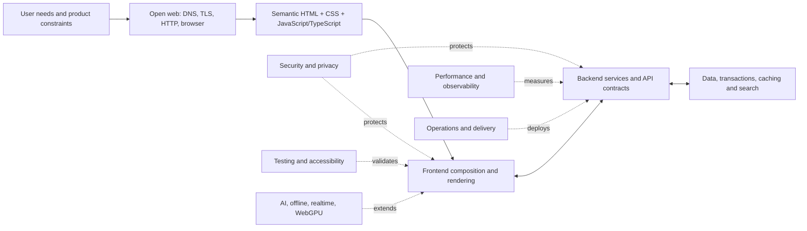

# Web Development Knowledge Atlas — 2026
**Edition:** 11 October 2026 · **Type:** educational knowledge graph / competency ontology
**Coverage:** 18 domains · 287 concepts · 37 typed cross-domain links · 5 learning journeys

> **Governing principle:** Understand the platform, model user value, trace data end to end, assure quality continuously, and treat the frontier as hypotheses to test.

## The operating model

The diagram is a **simplified operational path**. Actual projects form a graph with shared responsibilities, feedback loops and alternative architectural choices.

### Concept tiers
- **Core** — durable, transferable foundations. Learn early and practice repeatedly.
- **Extension** — situational professional depth. Learn where the work demands it.
- **Frontier** — emerging methods or capabilities to investigate. Their production readiness varies; **not** a blanket recommendation to deploy.

## Table of domains
| # | Domain | Layer | Core concepts | Extensions | Frontier concepts |
|---:|---|---|---:|---:|---:|
| 1 | [Product, users & UX](#domain-01) | Purpose & foundations | 9 | 5 | 2 |
| 2 | [Computing & engineering foundations](#domain-02) | Purpose & foundations | 9 | 5 | 2 |
| 3 | [Internet, HTTP & browser internals](#domain-03) | Open web platform | 9 | 5 | 2 |
| 4 | [HTML, semantics & accessibility](#domain-04) | Browser experience | 9 | 5 | 2 |
| 5 | [CSS & visual systems](#domain-05) | Browser experience | 9 | 5 | 2 |
| 6 | [JavaScript & TypeScript](#domain-06) | Browser experience | 9 | 5 | 2 |
| 7 | [Browser APIs & client capabilities](#domain-07) | Browser experience | 8 | 5 | 3 |
| 8 | [Frontend state & rendering architectures](#domain-08) | Application systems | 8 | 6 | 2 |
| 9 | [Servers, APIs & application logic](#domain-09) | Application systems | 9 | 5 | 2 |
| 10 | [Databases, search & data systems](#domain-10) | Application systems | 9 | 5 | 2 |
| 11 | [Security, identity & privacy](#domain-11) | Quality & operations | 9 | 5 | 2 |
| 12 | [Distributed systems & software architecture](#domain-12) | Application systems | 8 | 5 | 2 |
| 13 | [Testing, quality & correctness](#domain-13) | Quality & operations | 9 | 5 | 2 |
| 14 | [Performance, reliability & observability](#domain-14) | Quality & operations | 9 | 5 | 2 |
| 15 | [Deployment, cloud & platform operations](#domain-15) | Quality & operations | 9 | 5 | 2 |
| 16 | [Teamwork, documentation & maintainability](#domain-16) | Quality & operations | 8 | 5 | 2 |
| 17 | [Web specializations](#domain-17) | Specialization & frontier | 9 | 5 | 2 |
| 18 | [AI-native web & research frontier](#domain-18) | Specialization & frontier | 9 | 5 | 3 |

## 01. Product, users & UX
**Purpose:** Build the right thing before optimizing how to build it.
**Mental model:** A website mediates user goals, business constraints, information and human attention.

### Core
- **Users, jobs & contexts** — Specify who is served and the job they need to complete.
- **Requirements & constraints** — Record behaviors, nonfunctional needs, legal limits and success conditions.
- **Information architecture** — Organize content with meaningful labels, navigation and retrieval.
- **User journeys** — Trace tasks, decisions, errors and recovery paths across screens.
- **Interaction design** — Design feedback, affordances, states, and clear user control.
- **Visual hierarchy** — Guide attention through type, spacing, contrast and composition.
- **Responsive-first design** — Design for flexible screens, input modes and network conditions.
- **Content strategy** — Treat useful writing, microcopy and metadata as product components.
- **Usability research** — Validate assumptions with observation and realistic tasks.

### Professional extensions
- **Design systems** — Standardize tokens, patterns, components, states and governance.
- **Analytics & experimentation** — Define events, funnels, retention and privacy-preserving A/B tests.
- **SEO & discovery** — Make meaningful, crawlable, fast content that serves search intent.
- **Internationalization & localization** — Handle language, formats, pluralization, RTL and cultural context.
- **Consent & regulation** — Map privacy, accessibility and sector rules to product requirements.

### Frontier & research watch
- **AI-assisted user research** — Use AI for synthesis while validating against primary observations.
- **Agent-facing UX** — Design consent, previews and reversibility when software acts for a user.

**Demonstrate proficiency:** Interview two users, prototype a task flow, define success criteria, then run an accessibility-aware usability test.

**Primary references:** [Nielsen Norman Group](https://www.nngroup.com/) · [W3C WAI](https://www.w3.org/WAI/)

## 02. Computing & engineering foundations
**Purpose:** The durable mental models underneath frameworks.
**Mental model:** Software is state transformed by algorithms within resource, correctness and coordination constraints.

### Core
- **Programming logic** — Practice variables, functions, branching, loops, data structures and modules.
- **Algorithms & complexity** — Understand search, sorting, recursion and growth in time and memory.
- **Data representation** — Work with strings, numbers, JSON, binary, Unicode and encoding.
- **Processes & memory** — Understand stacks, heaps, CPU work, I/O and concurrency basics.
- **Command line & operating systems** — Navigate paths, permissions, environment variables and processes.
- **Git & version control** — Commit, branch, merge, review, revert and bisect changes.
- **Debugging & reasoning** — Reproduce, isolate, inspect and test hypotheses about failures.
- **Abstraction & modularity** — Define contracts and separate responsibilities without overengineering.
- **Data structures** — Choose maps, sets, arrays, trees and queues appropriate to access patterns.

### Professional extensions
- **Types & contracts** — Use static and dynamic checks, invariants and explicit boundaries.
- **Concurrency primitives** — Understand tasks, queues, locking and race conditions.
- **Computer architecture** — Learn CPU, disk, memory and network latency as design constraints.
- **Programming paradigms** — Apply procedural, object-oriented and functional styles pragmatically.
- **Architecture documentation** — Explain decisions, assumptions and tradeoffs as ADRs.

### Frontier & research watch
- **Formal methods & property verification** — Explore stronger correctness guarantees where stakes justify them.
- **AI-assisted software development** — Verify generated code through tests, review and understanding.

**Demonstrate proficiency:** Build and debug a small command-line application with tests, version control and documented tradeoffs.

**Primary references:** [MDN Learn](https://developer.mozilla.org/en-US/docs/Learn_web_development)

## 03. Internet, HTTP & browser internals
**Purpose:** The web is a distributed protocol and rendering system.
**Mental model:** A URL resolves to a request; a response becomes a document; the browser parses, styles, lays out, paints and executes code.
**Useful prerequisites:** Computing & engineering foundations

### Core
- **URLs, origins & sites** — Distinguish scheme, host, port, path, query and same-origin boundaries.
- **DNS, IP & routing** — Explain how hostnames resolve and packets reach a server.
- **TLS & HTTPS** — Protect connections with certificates and cryptographic negotiation.
- **HTTP semantics** — Understand methods, headers, status codes, requests and responses.
- **Caching** — Use Cache-Control, ETag, validators and CDNs appropriately.
- **Cookies & browser storage** — Understand origin-scoped storage and session transmission.
- **Browser rendering pipeline** — Trace parsing, style, layout, paint and compositing.
- **Event loop & tasks** — Distinguish microtasks, asynchronous I/O and main-thread blocking.
- **Cross-origin rules** — Understand same-origin policy, CORS and CSP at appropriate layers.

### Professional extensions
- **HTTP/2 & HTTP/3** — Evaluate multiplexing, transport and latency behavior.
- **Service workers** — Control selected network requests and support offline functionality.
- **Proxies, CDNs & edge** — Place caches and compute closer to users while preserving correctness.
- **Streams & backpressure** — Process data incrementally across network and runtime.
- **Navigation lifecycle** — Reason about bfcache, prerendering and page transitions.

### Frontier & research watch
- **WebTransport interoperability** — Track the evolving fit for low-latency bidirectional applications.
- **Navigation API interoperability** — Track standardized client-side navigation across browsers.

**Demonstrate proficiency:** Use browser DevTools to trace DNS, TLS, redirects, cache, request timing, DOM construction and paint for one page.

**Primary references:** [MDN how the web works](https://developer.mozilla.org/en-US/docs/Learn_web_development/Getting_started/Web_standards/How_the_web_works) · [Interop 2026](https://web.dev/blog/interop-2026)

## 04. HTML, semantics & accessibility
**Purpose:** Meaningful documents are the foundation of reliable UI.
**Mental model:** HTML expresses meaning and interaction contracts to browsers, search tools, assistive technology and humans.
**Useful prerequisites:** Internet, HTTP & browser internals · Product, users & UX

### Core
- **Semantic HTML** — Choose elements for their native meaning and behavior.
- **Document structure** — Use headings, landmarks, lists, links and valid nesting.
- **Forms & validation** — Label controls, group inputs and explain errors accessibly.
- **Keyboard & focus** — Support predictable tab order, visible focus and dialogs.
- **Accessible names & roles** — Make controls comprehensible to assistive technology.
- **Images, audio & video** — Provide alt text, captions, transcripts and alternatives.
- **Progressive enhancement** — Start with functional HTML, add improvements conditionally.
- **WCAG 2.2** — Apply perceivable, operable, understandable and robust principles.
- **Tables & structured content** — Use appropriate relationships and headers for complex data.

### Professional extensions
- **ARIA patterns** — Add ARIA only when native HTML cannot express a needed behavior.
- **Screen-reader testing** — Test real interaction, not only automated rule violations.
- **Accessibility trees** — Understand how browsers expose UI semantics.
- **Custom elements** — Encapsulate reusable interoperable UI with native browser primitives.
- **Localization of semantics** — Account for reading direction, text expansion and input methods.

### Frontier & research watch
- **WCAG 3 development** — Follow drafts without treating them as replacement conformance requirements.
- **Accessible complex interactions** — Test novel spatial, multimodal and agent-driven interfaces.

**Demonstrate proficiency:** Ship a fully keyboard-operable, labeled form with proper errors, focus handling and screen-reader testing.

**Primary references:** [WCAG 2.2](https://www.w3.org/TR/WCAG22/) · [WCAG 3 introduction](https://www.w3.org/WAI/standards-guidelines/wcag/wcag3-intro/)

## 05. CSS & visual systems
**Purpose:** Layout, adaptation and interaction without unnecessary script.
**Mental model:** The cascade, formatting contexts and constraints let a document adapt to varied environments.
**Useful prerequisites:** HTML, semantics & accessibility

### Core
- **Selectors, cascade & specificity** — Predict how styles resolve, including origin and layers.
- **Box model & sizing** — Understand content, padding, border, margins and intrinsic dimensions.
- **Flexbox & Grid** — Use one- and two-dimensional layout systems appropriately.
- **Responsive design** — Combine fluid type, media and container queries.
- **Typography & color** — Manage legibility, contrast, variable fonts and color spaces.
- **Custom properties & tokens** — Encode consistent colors, spacing and component decisions.
- **States & interactions** — Style focus, hover, invalid, disabled and user preferences.
- **Motion & reduced motion** — Animate purposefully while honoring user settings.
- **Logical properties** — Support multiple writing modes and directions.

### Professional extensions
- **Cascade layers & scope** — Manage style ownership and localized selectors.
- **Anchor positioning** — Build positioned popovers and anchored interfaces declaratively.
- **View transitions** — Animate navigation and state changes progressively.
- **Modern color functions** — Use relative colors, color-mix and perceptual spaces with care.
- **Design-system distribution** — Package tokens, components, documentation and compatibility.

### Frontier & research watch
- **Element-scoped view transitions** — Follow interoperability and component-boundary behavior.
- **Interop 2026 CSS features** — Monitor attr(), contrast-color() and shape() support.

**Demonstrate proficiency:** Create a responsive dashboard with grid, intrinsic sizing, container queries, logical properties and reduced-motion behavior.

**Primary references:** [MDN CSS](https://developer.mozilla.org/en-US/docs/Web/CSS) · [CSS @scope](https://developer.mozilla.org/en-US/docs/Web/CSS/Reference/At-rules/%40scope)

## 06. JavaScript & TypeScript
**Purpose:** The primary behavioral language of the open web.
**Mental model:** JavaScript coordinates events, computation and asynchronous work; TypeScript checks stated assumptions before runtime.
**Useful prerequisites:** Computing & engineering foundations · Internet, HTTP & browser internals · HTML, semantics & accessibility

### Core
- **Values, scope & closures** — Understand lexical bindings, references and encapsulated behavior.
- **Objects, arrays & modules** — Model collections, imports and reusable units.
- **DOM & events** — Manipulate interfaces safely using event propagation and delegation.
- **Async & promises** — Use async/await, error handling and concurrent operations.
- **Fetch & abort** — Handle network requests, cancellation, timeouts and response failures.
- **State & side effects** — Separate derived values from mutable state and external effects.
- **Error handling** — Distinguish expected failures, exceptions and recoverable states.
- **TypeScript essentials** — Use inference, unions, generics and narrowing for safer programs.
- **Tooling** — Use npm/pnpm, formatters, linters, bundlers and package scripts.

### Professional extensions
- **Deep type modeling** — Use discriminated unions, mapped types and type-level boundaries.
- **Memory & performance** — Profile allocation, leaks, long tasks and GC pressure.
- **Workers & concurrency** — Move suitable computation off the main thread.
- **Dependency management** — Audit provenance, semver, lockfiles and update risk.
- **Package design** — Publish typed, interoperable modules with explicit contracts.

### Frontier & research watch
- **AI-generated code verification** — Evaluate provenance, security, maintenance and behavior instead of trusting fluency.
- **Emerging JS APIs** — Adopt new primitives based on Baseline and target environments.

**Demonstrate proficiency:** Build a form-powered search interface with async fetching, abortable requests, loading/error states and tests.

**Primary references:** [MDN JavaScript](https://developer.mozilla.org/en-US/docs/Web/JavaScript) · [TypeScript Handbook](https://www.typescriptlang.org/docs/handbook/intro)

## 07. Browser APIs & client capabilities
**Purpose:** The browser is a powerful runtime, not just a document viewer.
**Mental model:** Native APIs expose storage, media, device input, scheduling and offline capability behind permissions and support constraints.
**Useful prerequisites:** Internet, HTTP & browser internals · HTML, semantics & accessibility · JavaScript & TypeScript

### Core
- **DOM, events & observers** — Use Mutation, Intersection and Resize observers without excess work.
- **Storage APIs** — Choose localStorage, IndexedDB and Cache Storage by need.
- **Service worker lifecycle** — Understand installation, activation, versioning and update traps.
- **PWA fundamentals** — Combine installability, offline mode and resilient UX.
- **URL & History APIs** — Control navigation while respecting browser expectations.
- **Media & device APIs** — Request camera, microphone and device access transparently.
- **Clipboard & sharing** — Use user-gesture-limited browser integration.
- **Permission model** — Handle denial, revocation, secure contexts and feature support.

### Professional extensions
- **Web Workers** — Parallelize CPU-heavy computation without DOM access.
- **WebRTC** — Build real-time media and peer connections.
- **Canvas, SVG & WebGL** — Choose rendering surfaces based on semantics and throughput.
- **WebAssembly** — Execute compiled modules for specialized tasks.
- **File System Access** — Offer file workflows with graceful fallback where supported.

### Frontier & research watch
- **WebGPU** — Explore compute and advanced graphics with compatibility fallbacks.
- **On-device browser AI** — Test native model APIs with support, privacy and UX gates.
- **WebTransport** — Evaluate datagrams and streams for suitable low-latency systems.

**Demonstrate proficiency:** Build a small offline-capable PWA and document every permission, fallback and storage failure.

**Primary references:** [MDN Web APIs](https://developer.mozilla.org/en-US/docs/Web/API) · [WebGPU](https://developer.mozilla.org/en-US/docs/Web/API/WebGPU_API)

## 08. Frontend state & rendering architectures
**Purpose:** Compose meaningful UI and choose where rendering happens.
**Mental model:** Rendering strategy trades off freshness, latency, complexity, caching, bundle size and interaction needs.
**Useful prerequisites:** HTML, semantics & accessibility · CSS & visual systems · JavaScript & TypeScript · Internet, HTTP & browser internals

### Core
- **Components & composition** — Build reusable units around clear contracts and ownership.
- **State management** — Distinguish local, shared, server and URL state.
- **Client-side routing** — Map URLs to UI with navigation, history and error states.
- **Data fetching & caching** — Handle stale data, mutation, invalidation and request races.
- **SPA vs MPA** — Choose navigation architecture according to experience and constraints.
- **SSR, SSG & CSR** — Select render time and location for each route.
- **Framework literacy** — Learn a framework deeply without conflating it with the platform.
- **Forms & mutations** — Keep submission, validation, optimistic UI and rollback coherent.

### Professional extensions
- **Streaming & suspense** — Deliver partial responses while preserving loading semantics.
- **Server Components** — Understand component boundaries and server-executed rendering.
- **Islands & partial hydration** — Hydrate only where interaction warrants it.
- **Signals & fine-grained updates** — Compare reactivity models and propagation costs.
- **Micro-frontends** — Evaluate ownership benefits against integration overhead.
- **Build-time & runtime boundaries** — Track what happens in browser, server and build tool.

### Frontier & research watch
- **New rendering hybrids** — Evaluate resumability, edge rendering and declarative server/client patterns.
- **Navigation/view-transition convergence** — Track alignment of router abstractions and native browser APIs.

**Demonstrate proficiency:** Build one application in two rendering modes and compare hydration cost, navigation and server/client responsibilities.

**Primary references:** [React Server Components](https://react.dev/reference/rsc/server-components) · [State of JS 2025](https://2025.stateofjs.com/en-US/libraries/meta-frameworks/)

## 09. Servers, APIs & application logic
**Purpose:** Turn requests into authorized, correct and observable behavior.
**Mental model:** A server validates input, enforces policy, coordinates durable state and returns an explicit contract.
**Useful prerequisites:** Internet, HTTP & browser internals · Computing & engineering foundations · JavaScript & TypeScript

### Core
- **Server runtimes & frameworks** — Choose runtime, ecosystem and hosting to fit workload.
- **Routing & middleware** — Compose request processing with controlled order and trust boundaries.
- **Validation & serialization** — Verify untrusted inputs and make output contracts explicit.
- **REST & resource modeling** — Use HTTP semantics for predictable interfaces.
- **Errors & status codes** — Give clients meaningful recovery signals without leaking sensitive data.
- **Authentication integration** — Verify identity without confusing it with authorization.
- **Pagination & filtering** — Bound resource use and give stable traversal semantics.
- **Background work & queues** — Move slow tasks out of synchronous request paths.
- **API documentation** — Describe schemas, examples, versioning and breaking changes.

### Professional extensions
- **GraphQL & typed RPC** — Trade flexible queries against query cost, coupling and operability.
- **Event-driven integrations** — Use brokers, retries, dead-letter queues and idempotent handlers.
- **Real-time protocols** — Choose SSE, WebSockets or WebRTC according to direction and latency.
- **Rate limiting & quotas** — Control abuse, overload and fairness at trust boundaries.
- **Idempotency & retries** — Make duplicate requests safe in unreliable networks.

### Frontier & research watch
- **AI-facing API contracts** — Expose narrowly scoped tools, typed inputs and auditable actions.
- **Streaming multimodal APIs** — Support structured partial delivery, cancellation and resource limits.

**Demonstrate proficiency:** Implement a documented CRUD API with pagination, authorization, idempotency and integration tests.

**Primary references:** [MDN HTTP](https://developer.mozilla.org/en-US/docs/Web/HTTP) · [OpenAPI](https://spec.openapis.org/oas/latest.html)

## 10. Databases, search & data systems
**Purpose:** Correct persistence comes from models, constraints and access patterns.
**Mental model:** Data systems trade consistency, query power, latency, availability and operational cost.
**Useful prerequisites:** Computing & engineering foundations · Servers, APIs & application logic

### Core
- **Relational modeling & SQL** — Use tables, relationships, joins and normalized structures.
- **Keys & constraints** — Preserve correctness with primary, foreign, unique and check constraints.
- **Transactions & ACID** — Keep multi-step changes atomic and isolation-aware.
- **Indexes & query plans** — Match physical access paths to real workloads.
- **Migrations & schema evolution** — Change persisted contracts without losing data.
- **Data lifecycle** — Plan retention, archival, deletion and ownership.
- **Caching** — Balance freshness, invalidation and load reduction.
- **Backups & recovery** — Test restores, recovery windows and disaster scenarios.
- **ORMs & query builders** — Use abstraction without losing visibility into generated queries.

### Professional extensions
- **Replication & partitioning** — Scale reads, placement and fault tolerance with tradeoffs.
- **NoSQL & document stores** — Use flexible models when access patterns justify them.
- **Full-text & vector search** — Compare lexical retrieval, embeddings and hybrid relevance.
- **Analytical pipelines** — Separate operational transactions from aggregation/warehouse workloads.
- **Event sourcing & CQRS** — Use when audit/replay or separate read models justify complexity.

### Frontier & research watch
- **Retrieval architectures for AI** — Test provenance, relevance, hybrid ranking and data permissions.
- **Local-first synchronization** — Explore conflict resolution and offline merge protocols.

**Demonstrate proficiency:** Design a relational schema with constraints, migrations, transactions, indexed queries and backup/restore rehearsal.

**Primary references:** [PostgreSQL docs](https://www.postgresql.org/docs/current/) · [MDN IndexedDB](https://developer.mozilla.org/en-US/docs/Web/API/IndexedDB_API)

## 11. Security, identity & privacy
**Purpose:** An always-on property of every layer and every change.
**Mental model:** Trust is never inferred from a UI; identity, authorization, input integrity and data protection need server-enforced boundaries.
**Useful prerequisites:** Internet, HTTP & browser internals · Servers, APIs & application logic · Databases, search & data systems

### Core
- **Threat modeling** — Inventory assets, entry points, attackers, misuse and mitigations.
- **Authentication vs authorization** — Distinguish proving identity from granting permitted actions.
- **Sessions, cookies & CSRF** — Apply SameSite, HttpOnly, Secure and anti-CSRF strategies appropriately.
- **Injection & XSS** — Encode output, validate input and use parameterized queries.
- **Broken access control** — Check every object, action and property server-side.
- **Secrets & key management** — Isolate credentials, rotate them and avoid committing secrets.
- **Transport & browser defenses** — Enforce HTTPS, CSP, CORS and security headers correctly.
- **Privacy by design** — Minimize collection, retention, sharing and unnecessary tracking.
- **Dependency & supply-chain security** — Manage packages, SBOMs, updates and provenance.

### Professional extensions
- **OAuth 2.x / OpenID Connect** — Separate delegated access from identity assertions.
- **Passkeys / WebAuthn** — Use phishing-resistant public-key authentication and recovery planning.
- **Security testing** — Combine SAST, DAST, dependency and manual adversarial tests.
- **Multi-tenant isolation** — Enforce tenant-scoped queries and least privilege.
- **Incident response** — Prepare containment, evidence preservation and recovery procedures.

### Frontier & research watch
- **Agent/tool authorization** — Scope AI tool permissions and require approval for sensitive actions.
- **AI prompt injection defenses** — Treat external documents and model outputs as untrusted input.

**Demonstrate proficiency:** Threat-model an application; test object-level authorization, XSS and CSRF defenses and credential recovery.

**Primary references:** [OWASP Top 10:2025](https://top10.owasp.org/2025/0x00_2025-Introduction/) · [MDN passkeys](https://developer.mozilla.org/en-US/docs/Web/Security/Authentication/Passkeys) · [OWASP LLM Risks](https://genai.owasp.org/llmrisk/llm062025-excessive-agency/)

## 12. Distributed systems & software architecture
**Purpose:** Organize boundaries so change and failure stay manageable.
**Mental model:** Architecture is the arrangement of responsibilities, data ownership, communication and failure containment.
**Useful prerequisites:** Servers, APIs & application logic · Databases, search & data systems · Security, identity & privacy

### Core
- **Separation of concerns** — Draw boundaries by responsibilities and invariants.
- **Modularity & contracts** — Keep internal changes from destabilizing consumers.
- **Monolith vs services** — Prefer the simplest deployable boundary that satisfies team and scale needs.
- **Sync vs async** — Choose request-response or messaging based on latency and coupling.
- **State ownership** — Define the canonical source of truth for each fact.
- **Consistency models** — Understand read-after-write, eventual consistency and stale reads.
- **Failure & retries** — Design timeouts, backoff, circuit breakers and idempotency.
- **Scalability basics** — Distinguish vertical scaling, horizontal scaling and bottlenecks.

### Professional extensions
- **Domain-driven design** — Model domain language, aggregates and bounded contexts.
- **Eventual consistency & sagas** — Coordinate distributed work without a global transaction.
- **Multi-region delivery** — Balance latency, availability, legal locality and consistency.
- **Resilience engineering** — Use bulkheads, graceful degradation and chaos experiments.
- **Architecture decision records** — Record context, choices and reversibility.

### Frontier & research watch
- **Edge/data locality architectures** — Evaluate computation placement with privacy and consistency tradeoffs.
- **Agentic orchestration systems** — Architect multi-step, supervised workflows with durable state.

**Demonstrate proficiency:** Draw a C4-style diagram; specify failure domains, contracts, latency budgets and recovery behavior.

**Primary references:** [C4 model](https://c4model.com/) · [Cloudflare architecture](https://developers.cloudflare.com/learning-paths/)

## 13. Testing, quality & correctness
**Purpose:** Quality must be demonstrated, not inferred from a green build.
**Mental model:** Different tests provide different evidence; choose the smallest test that detects the intended failure.
**Useful prerequisites:** Computing & engineering foundations · Frontend state & rendering architectures · Servers, APIs & application logic

### Core
- **Unit testing** — Check isolated logic, edge cases and invariants.
- **Integration testing** — Test boundaries across modules, DBs and external contracts.
- **End-to-end testing** — Exercise real user workflows in a browser.
- **Accessibility testing** — Combine automation with keyboard, screen-reader and usability checks.
- **Cross-browser/device testing** — Validate supported engines, viewports and input modalities.
- **Contract & schema tests** — Detect incompatible consumer/provider changes.
- **Static checks** — Run typechecking, linting, formatting and security scans.
- **Test data & fixtures** — Use representative data without exposing personal records.
- **CI quality gates** — Make repeatable evidence part of every change.

### Professional extensions
- **Property-based testing** — Generate cases to test invariants beyond hand-written examples.
- **Visual regression** — Detect unexpected rendering changes without replacing semantic tests.
- **Performance & load testing** — Observe behavior across realistic concurrency and network profiles.
- **Mutation testing** — Evaluate whether tests actually catch code defects.
- **Chaos & resilience testing** — Rehearse failure scenarios safely.

### Frontier & research watch
- **AI output evaluations** — Test groundedness, tool decisions, policy and regression suites.
- **Browser interoperability automation** — Track emerging features with compatibility and conformance tests.

**Demonstrate proficiency:** Create a CI suite of unit, API integration, browser E2E and accessible interaction tests with realistic seed data.

**Primary references:** [Playwright](https://playwright.dev/docs/intro) · [Web Platform Tests](https://web-platform-tests.org/)

## 14. Performance, reliability & observability
**Purpose:** Optimize outcomes users experience and the system can sustain.
**Mental model:** Measure from the user inward: experience metrics, trace spans, dependencies and bottlenecks.
**Useful prerequisites:** Internet, HTTP & browser internals · Frontend state & rendering architectures · Servers, APIs & application logic

### Core
- **Core Web Vitals** — Track LCP, INP and CLS using field data.
- **Performance budgets** — Limit transfer, scripting, images and critical-path work.
- **Critical rendering path** — Reduce render-blocking and layout/paint work.
- **Asset optimization** — Use responsive images, caching, compression and font loading.
- **JS execution costs** — Avoid unnecessary hydration, long tasks and memory leaks.
- **APM and telemetry** — Collect metrics, logs and distributed traces.
- **SLIs, SLOs & error budgets** — Define service reliability based on user outcomes.
- **Capacity and load** — Understand throughput, concurrency, queues and saturation.
- **Debugging regressions** — Compare deployments and trace changes to root causes.

### Professional extensions
- **Real-user monitoring vs lab** — Combine observed user conditions with repeatable diagnostics.
- **Sampling & cardinality** — Balance telemetry costs with diagnostic value.
- **Tracing distributed requests** — Follow latency and errors through services and storage.
- **Queueing theory** — Understand utilization, tail latency and cascading overload.
- **Green web engineering** — Consider energy, transfer and computation waste.

### Frontier & research watch
- **INP-driven interaction architecture** — Revisit scheduling and main-thread work to improve responsiveness.
- **Observability for AI workflows** — Trace prompts, tool calls, privacy boundaries, cost and outcome quality.

**Demonstrate proficiency:** Instrument real-user Web Vitals and server traces, set a performance budget, then remove the top measured bottleneck.

**Primary references:** [Web Vitals](https://web.dev/articles/vitals) · [OpenTelemetry](https://opentelemetry.io/docs/concepts/observability-primer/)

## 15. Deployment, cloud & platform operations
**Purpose:** Get reliable, secure software into real users’ hands.
**Mental model:** A deployment is a controlled change to a live system, not the final step of local development.
**Useful prerequisites:** Servers, APIs & application logic · Security, identity & privacy · Testing, quality & correctness

### Core
- **Build & artifact pipeline** — Produce reproducible assets from versioned inputs.
- **CI/CD** — Automate verification, promotion and deployment safely.
- **Hosting models** — Compare static, managed app, serverless, containers and virtual machines.
- **DNS, TLS & CDN setup** — Configure public delivery and certificate renewal.
- **Configuration & secrets** — Separate settings and credentials by environment.
- **Containers** — Package application processes and runtime dependencies.
- **Environment parity** — Reduce test/prod differences without blocking delivery.
- **Rollback & release strategies** — Use gradual rollout, feature flags and fast recovery.
- **Monitoring & alerting** — Alert on user-visible failures and actionable conditions.

### Professional extensions
- **Infrastructure as code** — Manage reproducible environments with reviewable definitions.
- **Kubernetes & orchestration** — Use only where deployment and reliability demands justify it.
- **Edge/serverless limits** — Understand cold starts, execution quotas and state boundaries.
- **FinOps** — Monitor infra cost, capacity and unit economics.
- **SRE & incident management** — Run incident response, postmortems and improvement loops.

### Frontier & research watch
- **Software supply-chain attestations** — Track provenance and verification of delivered artifacts.
- **Platform engineering & golden paths** — Improve team autonomy using paved, auditable workflows.

**Demonstrate proficiency:** Ship a small service via CI/CD with HTTPS, environment separation, rollback, alerts and a documented restore drill.

**Primary references:** [OpenTelemetry](https://opentelemetry.io/docs/) · [OWASP Top 10:2025](https://top10.owasp.org/2025/0x00_2025-Introduction/)

## 16. Teamwork, documentation & maintainability
**Purpose:** Engineering is a continuous collaboration and change process.
**Mental model:** A codebase survives through shared understanding, clear ownership, reversible decisions and feedback.
**Useful prerequisites:** Computing & engineering foundations · Product, users & UX

### Core
- **Code review** — Evaluate correctness, readability, security and knowledge sharing.
- **Issue and project management** — Make scope, ownership, dependencies and outcomes visible.
- **Documentation** — Record how to use, run, extend and operate the product.
- **Developer experience** — Improve setup, feedback speed and local reproducibility.
- **Versioning & compatibility** — Plan API and package evolution without surprise breakage.
- **Refactoring** — Improve internal structure while preserving observable behavior.
- **Technical debt** — Assess the cost and risk of postponed design work.
- **Communication** — Explain technical tradeoffs clearly to different stakeholders.

### Professional extensions
- **Incident postmortems** — Build learning systems rather than individual blame.
- **Ownership & boundaries** — Define who reviews, operates and decides for each system.
- **Open source & licensing** — Respect dependency obligations and contribution rules.
- **Developer portals & internal tooling** — Make service knowledge and paved workflows discoverable.
- **Governance & compliance evidence** — Maintain audit trails and control ownership proportionately.

### Frontier & research watch
- **Human-AI code review** — Require traceable tests and security review for generated changes.
- **Knowledge preservation under AI workflows** — Track decisions and intent beyond code generation.

**Demonstrate proficiency:** Document an architectural decision, review another developer’s change, and prepare a safe release checklist.

**Primary references:** [MDN Learn](https://developer.mozilla.org/en-US/docs/Learn_web_development) · [OpenSSF](https://openssf.org/)

## 17. Web specializations
**Purpose:** Different products imply different hard problems.
**Mental model:** Specialization starts from requirements—latency, regulation, content, devices, search, collaboration—not from fashion.
**Useful prerequisites:** Frontend state & rendering architectures · Servers, APIs & application logic · Security, identity & privacy

### Core
- **Content websites & CMS** — Optimize authoring, structured content, SEO and publishing workflows.
- **Commerce & payments** — Manage catalog, tax, inventory, fraud, idempotency and payment compliance.
- **Real-time collaboration** — Synchronize presence, edits, conflicts and permissions.
- **Media & streaming** — Understand codecs, adaptive delivery and accessibility.
- **Maps & geospatial** — Model coordinates, tiles, routing and location privacy.
- **Mobile/PWA** — Design installability, offline behavior and touch-first interaction.
- **International web** — Handle locales, languages, calendars, currency and legal variation.
- **Data visualization** — Choose accurate graphical encodings and accessible alternatives.
- **Enterprise applications** — Handle identity federation, RBAC and multi-tenant data.

### Professional extensions
- **3D & immersive web** — Use graphics, spatial interaction and device capability checks.
- **Scientific & compute-heavy web** — Combine WebAssembly and workers with progressive fallbacks.
- **Local-first applications** — Build reliable offline editing, conflict resolution and synchronization.
- **Embedded widgets & extensions** — Manage isolation, messaging, CSP and integration contracts.
- **Search & discovery platforms** — Combine indexing, retrieval, relevance and evaluation.

### Frontier & research watch
- **On-device graphics/ML via WebGPU** — Track execution and compatibility for specialist products.
- **Agent-integrated workflows** — Design auditable task automation with permission boundaries.

**Demonstrate proficiency:** Choose one specialization, state its nonfunctional requirements, and prototype the key architectural tradeoff.

**Primary references:** [MDN APIs](https://developer.mozilla.org/en-US/docs/Web/API) · [web.dev](https://web.dev/)

## 18. AI-native web & research frontier
**Purpose:** A new application layer—useful, uncertain and security-sensitive.
**Mental model:** A trustworthy AI feature combines models, verified data, tools, human controls, evaluation and observability.
**Useful prerequisites:** Servers, APIs & application logic · Databases, search & data systems · Security, identity & privacy · Testing, quality & correctness

### Core
- **AI product problem framing** — Check whether probabilistic generation solves the user task.
- **Model APIs & streaming** — Handle structured responses, latency, errors and cancellation.
- **Retrieval-augmented generation** — Retrieve permission-filtered context with source attribution.
- **Embeddings & hybrid search** — Combine vector and lexical signals for relevance.
- **Context & prompt design** — Treat instructions, data and tool schemas as separate trust levels.
- **Tool calling** — Expose typed, least-privileged operations with validation.
- **Human-in-the-loop controls** — Require previews, confirmation and safe undo where warranted.
- **AI evaluation** — Measure quality, groundedness, safety, latency and regressions.
- **Privacy & data governance** — Control disclosure, retention, data location and auditability.

### Professional extensions
- **Agent orchestration** — Model multi-step plans as durable, recoverable state machines.
- **MCP interoperability** — Understand tool/resource contracts and authorization boundaries.
- **Multimodal UX** — Design around speech, images and text with accessible alternatives.
- **Cost & latency engineering** — Budget tokens, caching and model choice across tasks.
- **AI red teaming** — Test prompt injection, exfiltration, excessive agency and failure recovery.

### Frontier & research watch
- **Browser-native AI APIs** — Explore on-device features with browser-specific availability checks.
- **Agentic web interoperability** — Monitor standards and adoption without promising universal compatibility.
- **AI-generated interfaces** — Study controllability, consistency, transparency and measurable user benefit.

**Demonstrate proficiency:** Prototype a citation-aware assistant over permitted documents; add evaluation cases, red-team prompts and human approval for tool actions.

**Primary references:** [Chrome built-in AI](https://developer.chrome.com/docs/ai/built-in-apis) · [MCP Specification](https://modelcontextprotocol.io/specification/) · [OWASP LLM Risks](https://genai.owasp.org/llmrisk/llm062025-excessive-agency/)

## Five pathways with outcome-based capstones
### 1. Complete beginner
Start with the platform before any framework. Publish early; test access and usability.
**Progression:** Product, users & UX → Computing & engineering foundations → Internet, HTTP & browser internals → HTML, semantics & accessibility → CSS & visual systems → JavaScript & TypeScript → Testing, quality & correctness → Deployment, cloud & platform operations
**Capstone:** A fast, accessible, responsive public site with a validated form and a real deployed URL.

### 2. Frontend specialist
Master semantic UX, rendering, client-side state and real-user performance.
**Progression:** Internet, HTTP & browser internals → HTML, semantics & accessibility → CSS & visual systems → JavaScript & TypeScript → Browser APIs & client capabilities → Frontend state & rendering architectures → Testing, quality & correctness → Performance, reliability & observability → Security, identity & privacy
**Capstone:** An offline-capable dashboard with keyboard navigation, loading/error states and performance budgets.

### 3. Backend & data specialist
Focus on contracts, persistence, trust, deployment and failure behavior.
**Progression:** Computing & engineering foundations → Internet, HTTP & browser internals → Servers, APIs & application logic → Databases, search & data systems → Security, identity & privacy → Distributed systems & software architecture → Testing, quality & correctness → Deployment, cloud & platform operations → Performance, reliability & observability
**Capstone:** A production-oriented API with authorization, transactional data, queues, tracing and recovery checks.

### 4. Full-stack product engineer
Trace every user action end-to-end, then add engineering safeguards.
**Progression:** Product, users & UX → Internet, HTTP & browser internals → HTML, semantics & accessibility → CSS & visual systems → JavaScript & TypeScript → Frontend state & rendering architectures → Servers, APIs & application logic → Databases, search & data systems → Security, identity & privacy → Testing, quality & correctness → Deployment, cloud & platform operations → Performance, reliability & observability
**Capstone:** A user-tested multi-user SaaS prototype with authentication, billing sandbox, audit logs and measured performance.

### 5. AI-native web engineer
Build and evaluate a normal secure web service before adding probabilistic features.
**Progression:** Internet, HTTP & browser internals → JavaScript & TypeScript → Frontend state & rendering architectures → Servers, APIs & application logic → Databases, search & data systems → Security, identity & privacy → Testing, quality & correctness → Performance, reliability & observability → AI-native web & research frontier
**Capstone:** A retrieval-backed assistant with citations, permission filtering, instrumented tool calls and approval gates.

## High-value distinctions
- **HTML semantics ≠ ARIA decoration.** Use native interactive elements first; layer ARIA on top only when needed.
- **Authentication ≠ authorization.** Every action and data access must be authorized independently of identity verification.
- **TypeScript types ≠ runtime input validation.** Static checks cannot make external data trustworthy.
- **Server rendering ≠ server components ≠ static generation.** They solve related but distinct deployment and rendering problems.
- **Unit tests ≠ integration tests ≠ accessible UX tests.** Different methods reveal different classes of defect.
- **Faster build tool ≠ faster website.** Measure real user Core Web Vitals and application bottlenecks.
- **Model capability ≠ tool authority.** AI-integrated systems need permission checks, auditability, evaluation and recovery.
- **Technology adoption ≠ architectural correctness.** Select by constraints, tradeoffs, performance evidence and team capability.

## As-of-2026 evidence and update discipline
- **Browser support:** consult [MDN Baseline](https://developer.mozilla.org/en-US/docs/Glossary/Baseline/Compatibility); “newly available” is not the same as support for older browsers or assistive technologies.
- **Interoperability:** [Interop 2026](https://web.dev/blog/interop-2026) prioritizes cross-browser behavior for navigation, view transitions, CSS, WebTransport, WebRTC and related features.
- **Accessibility:** [WCAG 2.2](https://www.w3.org/TR/WCAG22/) is a Recommendation. [WCAG 3](https://www.w3.org/WAI/standards-guidelines/wcag/wcag3-intro/) remains a Working Draft (September 2026).
- **Security:** check [OWASP Top 10:2025](https://top10.owasp.org/2025/0x00_2025-Introduction/) and, for model-integrated apps, [OWASP GenAI](https://genai.owasp.org/llmrisk/llm062025-excessive-agency/).
- **Performance:** use [Core Web Vitals](https://web.dev/articles/vitals) — LCP, INP and CLS — preferably from real user data and repeated field measurements.
- **Framework signals:** [State of JS 2025](https://2025.stateofjs.com/en-US/) is an ecosystem survey, not a universal census or normative best-practice guide.
- **Browser-native AI & GPU:** [Chrome built-in AI](https://developer.chrome.com/docs/ai/built-in-apis) has API-specific availability; [WebGPU](https://developer.mozilla.org/en-US/docs/Web/API/WebGPU_API) is not Baseline universally. Provide fallbacks and assess device support.

## Graph schema and governance
A machine-readable companion JSON records each domain with a stable `id`, human-oriented definition, prerequisite domain IDs, priority-tiered concepts, primary references, and an outcome-based exercise. It also records typed cross-domain relationships: `prerequisite`, `informs`, `calls`, `uses`, `secures`, `measures`, `gates`, `evaluates`, and more.
**Maintenance rule:** review source-linked features quarterly; revisit security guidance after material vulnerabilities; keep durable conceptual nodes stable when frameworks or version-specific tooling changes.

**Scope caveat:** this map is a deliberately opinionated synthesis for broad web-development competence, not a claim that one person must master every specialization or that all techniques can/should be combined in one application.
